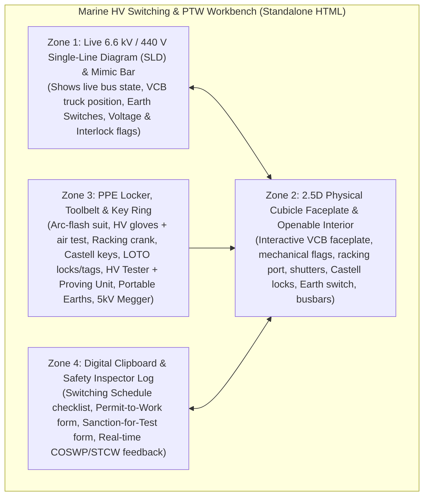

# Project Handover: Marine High Voltage (6.6 kV) Switching & Permit-to-Work (PTW) Simulator

## 1. Executive Summary & Project Goal
Build a standalone, highly interactive **Marine High Voltage (6.6 kV) Switching & Permit-to-Work (PTW) Simulator** designed for **Electro-Technical Officer (ETO)** cadets and Marine Engineering students.

This simulator trains and assesses students on high-voltage safe isolation, mechanical & Castell key interlocks, Vacuum Circuit Breaker (VCB) racking, Live-Line "Prove–Test–Prove" verification, integral and portable earthing (Circuit Main Earth - CME), Lockout/Tagout (LOTO), Insulation Resistance / Polarization Index (Megger) testing under a Sanction-for-Test, and formal Maritime Permit-to-Work (PTW) documentation.

> [!IMPORTANT]
> **Critical Deliverable Requirement — Standalone `.html` File:**
> The repository **MUST** contain a self-contained, zero-dependency **standalone `.html` file** (e.g., `index.html` or `marine-hv-simulator.html` in the repo root) that includes all HTML, CSS, SVG graphics, Web Audio sound synthesis, and JavaScript logic in a single portable file (or builds directly into a single standalone `.html` file committed to the repo root). A user or student must be able to double-click the `.html` file locally or open it via GitHub Pages with zero build step required to run it.

---

## 2. Regulatory & Maritime Law Compliance
Every mechanical interlock, procedure, warning tag, and assessment check must strictly adhere to international maritime law and standards:

1. **STCW 2010 Manila Amendments (Table A-III/6 & Section B-III/2):**
   * Mandatory minimum requirements for certification of Electro-Technical Officers (High Voltage installations $>1,000\text{ V}$ operational and safety competency).
2. **IEC 60092-503:**
   * *Electrical installations in ships — Part 503: Special features — AC supply systems with voltages in the range of above 1 kV up to and including 15 kV.*
   * Governs mandatory mechanical interlocks between circuit breakers, withdrawable trucks, safety shutters, earthing switches, and enclosure doors.
3. **UK MCA Code of Safe Working Practices for Merchant Seafarers (COSWP) — Chapter 22 (High Voltage Systems):**
   * Enforces the **5 Golden Rules of HV Safety**:
     1. Disconnect completely (All-pole isolation from all sources of supply, including LV back-feed).
     2. Secure against re-connection (LOTO padlocks, shutter locks, Castell trapped keys, warning tags).
     3. Verify that the installation is dead (*Prove – Test – Prove* at the point of work).
     4. Carry out earthing and short-circuiting (Integral Fault-Making Earth Switch and/or Portable Circuit Main Earth leads).
     5. Provide protection against adjacent live parts (Barriers, shutter locks) and issue formal **Permit-to-Work (PTW)** or **Sanction-for-Test (SFT)**.

---

## 3. System Topology to Simulate (6.6 kV Marine Switchboard)
Model an industrial 6.6 kV, 60 Hz, 3-phase insulated-neutral (or high-resistance grounded) marine main switchboard (modeled after ABB UniGear ZS1 / Schneider Marine HV switchgear) with a linked 440 V Low Voltage (LV) sub-panel to teach back-feed hazards:

* **Cubicle 1: HV Diesel Generator 1 (`DG1 - 6.6 kV`)** — Incoming supply feeder.
* **Cubicle 2: Bus-Tie Breaker (`BT1 - 6.6 kV`)** — Splits Port and Starboard 6.6 kV bus sections.
* **Cubicle 3: Bow Thruster HV Motor Feeder (`BT-M1 - 6.6 kV, 1,800 kW`)** — Primary target for Mission 1 (Standard Isolation) & Mission 3 (5 kV Megger / PI Test).
* **Cubicle 4: HV/LV Step-Down Transformer Feeder (`TR1 - 6.6 kV / 440 V`)** — Connected to a **440 V Secondary Breaker (`ACB-TR1-LV`)** on the LV Switchboard. Primary target for Mission 2 (Dual-End Isolation & Back-Feed Prevention via Castell Key exchange).

---

## 4. UI / UX Architecture (2.5D Interactive Multi-View Workbench)
Do **not** use heavy external 3D engines. Use crisp, industrial **2.5D Interactive Vector Graphics (SVG + HTML5 Canvas + CSS3 animations + Web Audio API synthesized mechanical clunks/buzzers)** arranged in a 4-Zone Tactical Workbench:

### Zone 1: Live Single-Line Diagram (SLD)
* Interactive top/side mimic showing energized buses in glowing red (`6.6 kV LIVE`), de-energized buses in grey (`0 V`), and earthed circuits in green (`EARTHED`).
* Allows clicking any cubicle (`DG1`, `BT1`, `Bow Thruster`, `Transformer TR1`, or `440V LV Breaker`) to inspect and operate it in Zone 2.

### Zone 2: 2.5D Physical Switchgear Cubicle (Front Faceplate & Openable Interior)
Each HV cubicle must render two toggleable/interactive layers:
1. **Closed Door / Front Faceplate View:**
   * Local/Remote selector switch (`LOCAL` / `REMOTE`).
   * Mechanical pushbuttons (`CLOSE [I]`, `TRIP [O]`) and spring status indicator (`SPRING CHARGED` / `DISCHARGED`).
   * Mechanical VCB Truck Position Indicator (`SERVICE`, `TEST`, `DISCONNECTED`) with continuous crank progress bar ($0\text{ to }20\text{ turns}$).
   * Racking Port with sliding mechanical shutter (requires `Racking Crank Handle`).
   * **VCB Castell Key Lock (`K1` / `K2`):** Key is trapped when VCB is in `SERVICE` or `TEST`. Can only be turned and extracted when VCB is `DISCONNECTED` (locking the VCB truck out).
   * **Integral Fault-Making Earthing Switch:** Includes a Castell Key slot, mechanical status flag (`OPEN` / `EARTHED`), padlock hasp, and hex socket for the `Earthing Operating Lever`.
   * **Capacitive Voltage Indicator (CVI) Ports:** `L1`, `L2`, `L3` LEDs + test sockets on the panel front.
   * **Door Interlock Latch:** Physically locked until the VCB is `DISCONNECTED` and the Integral Earth Switch is `EARTHED` (unless overridden under a *Sanction-for-Test* procedure).
2. **Open Door / Internal Compartment View:**
   * **Automatic Metallic Shutters:**
     * Top Shutter (**RED — "DANGER 6.6 kV BUSBARS"**): Covers the live upper busbar spouts when the VCB truck is withdrawn. Includes a padlock hasp.
     * Bottom Shutter (**YELLOW — "CABLE / FEEDER TERMINALS"**): Covers the lower cable spouts.
   * **Exposed Lower Feeder Terminals (`L1`, `L2`, `L3`) & Main Earth Bar (`PE`):** Used for applying the **HV Live-Line Voltage Detector Rod**, **Portable Earthing Leads (CME)**, and **5 kV Insulation Resistance Tester (Megger)**.

### Zone 3: Interactive PPE Locker, Toolbelt & Key Ring
Students must click to equip PPE or pick up a tool before interacting with hotspots on the switchgear:
1. **PPE Items (Must be equipped before HV switching/opening doors):**
   * `Arc-Flash Switching Suit & Hood (40 cal/cm²)`
   * `Class 2 HV Insulating Gloves (17 kV tested)` — **Interactive Feature:** Include a *"Perform Glove Air-Leak Roll Test"* button! In STCW HV exams, failing to air-test HV gloves before putting them on is an automatic deduction.
   * `Dielectric Boots & 15 kV Insulating Deck Mat`
2. **Operating Tools & Keys:**
   * `VCB Racking Crank Handle` (for racking between `SERVICE` $\leftrightarrow$ `TEST` $\leftrightarrow$ `DISCONNECTED`).
   * `Earthing Switch Operating Handle` (for slamming open/closed the integral fault-making earth switch).
   * `Castell Key Ring` (holds extracted keys like `K1-BT`, `K2-TR-HV`, `K3-TR-LV` with stamped codes).
   * `LOTO Padlocks (Red Personal Padlocks)` & `Safety Key Box`.
   * `Warning Tags`:
     * *"DANGER — DO NOT OPERATE (MEN WORKING)"*
     * *"CAUTION — EARTH SWITCH CLOSED"*
     * *"DANGER — HIGH VOLTAGE TEST IN PROGRESS (SANCTION FOR TEST)"*
3. **Test & Earthing Instruments:**
   * `HV Potential Indicator (Live-Line Detector Rod, 6.6 kV)` + `Electronic Proving Unit`.
   * `Portable Earthing Leads (Circuit Main Earth - CME)` with insulated Hot-Stick applicator.
   * `5,000 V DC Insulation Resistance / PI Tester (Megger)` with `L1/L2/L3` and `Earth` leads + auto-discharge circuit.

### Zone 4: Digital Clipboard (PTW, Sanction-for-Test & Switching Schedule)
* **Interactive Permit-to-Work (PTW) Form:**
  * Fields that the student must toggle/verify before signing:
    1. Circuit Identified & Remotely Stopped
    2. Circuit Breaker Tripped, Racked Out to `DISCONNECTED`, Shutters Locked
    3. Back-feed Sources Isolated & Locked (if applicable)
    4. Tested Dead via *Prove – Test – Prove*
    5. Circuit Earthed at Point of Work & Locked (`CME` / Integral Earth)
    6. Warning Notices Posted & Keys Secured in Key Box
    7. Signatures: *Authorized Person (Senior ETO)* & *Competent Person Receiving Permit*
* **Interactive Sanction-for-Test (SFT) Form:**
  * Required during Mission 3 before removing earths on an isolated HV cable/motor to perform a 5 kV Megger test.

---

## 5. Mechanical & Electrical Interlock Truth Table
The simulation engine must strictly enforce these physical rules:

| Action Attempted by Student | Required Pre-Conditions | Result if Pre-Conditions Not Met |
| :--- | :--- | :--- |
| **Insert Racking Handle / Rack VCB** | VCB must be `OPEN (TRIPPED)` AND Racking Port padlock removed. | **Mechanical Interlock Block:** Shutter flap refuses to open while VCB is `CLOSED`. |
| **Close VCB (`[I]`)** | VCB must be completely in `SERVICE` or completely in `TEST` (never mid-travel), Spring `CHARGED`, and Earth Switch `OPEN`. | **Mechanical Interlock Block:** Closing coil and mechanical latch blocked. |
| **Extract VCB Castell Key (`K1`)** | VCB must be in `DISCONNECTED` position and key turned to `LOCKED`. | **Key Trapped:** Key cannot be rotated or removed while in `SERVICE` or `TEST`. |
| **Close Integral Earth Switch** | VCB must be `DISCONNECTED`, matching Castell Key inserted & turned, and Earth Switch padlock removed. | **Mechanical Interlock Block:** Cannot earth a live breaker slot! |
| **Open HV Cubicle Door** | VCB `DISCONNECTED` AND Integral Earth Switch `CLOSED` (or SFT Door Bypass Key used after proving dead). | **Door Interlock Engaged:** Steel door remains bolted shut. |
| **Close HV Transformer Feeder (`TR1`)** |HV side ready; if LV Breaker `ACB-TR1-LV` is closed on a live 440V bus while HV door is open $\rightarrow$ **6.6 kV Back-Feed!** | **Catastrophic Arc-Flash / Electrocution** if student touches terminals without isolating 440V LV back-feed. |
| **Attach Portable Earth Leads (CME)** | Must connect **Earth Clamp to Ship's Earth Bar (`PE`) FIRST**, then attach Phase Clamps (`L1`, `L2`, `L3`) via Hot-Stick. | **Safety Violation / Hazard:** Attaching phase clamp before earth bar connection triggers an immediate STCW violation alert. |
| **Run 5 kV Megger Test** | Circuit must be isolated, **Sanction-for-Test active**, and Earth Switch temporarily `OPEN`. | If Earth Switch is still `CLOSED`, Megger reads $0.0\text{ M}\Omega$ (dead short to earth) and warns student. |

---

## 6. The "Prove – Test – Prove" State Machine
Track a 3-step verification state whenever the student verifies dead busbars/terminals:
1. `STATE_0 (Unverified)` $\rightarrow$ Student touches HV Detector Rod to **Proving Unit** $\rightarrow$ Tester LEDs flash & beep $\rightarrow$ Advances to `STATE_1 (Tester Proven_Pre)`.
2. `STATE_1` $\rightarrow$ Student touches HV Detector Rod to `L1`, `L2`, and `L3` terminals $\rightarrow$ Confirms $0.0\text{ kV}$ on all 3 phases $\rightarrow$ Advances to `STATE_2 (Phases Tested Dead)`.
3. `STATE_2` $\rightarrow$ Student immediately touches HV Detector Rod back to **Proving Unit** $\rightarrow$ Tester LEDs flash & beep $\rightarrow$ Advances to `STATE_3 (Prove-Test-Prove Complete ✅)`.

*If the student skips Step 1 or Step 3 and signs the PTW or applies portable earths, trigger a **Procedural Safety Violation** explaining why an unverified HV tester can cost an ETO their life.*

---

## 7. Built-In Training & Assessment Missions
Include a Mission Selector with **Training Mode** (step-by-step guided hints, checklist highlights, and safe warnings) and **Exam / CoC Assessment Mode** (no hints, strict scoring out of 100, and catastrophic fault consequences):

### Mission 1: Bow Thruster 6.6 kV Motor Isolation & PTW Issuance
* **Objective:** Safely isolate the 6.6 kV Bow Thruster motor (`BT-M1`) so engineers can replace the drive-end bearing.
* **Key Steps:**
  1. Equip full HV PPE (including Glove Air-Leak Roll Test).
  2. Verify Bow Thruster is stopped and set control to `LOCAL`.
  3. Trip VCB (`OPEN`), rack VCB out from `SERVICE` $\rightarrow$ `TEST` $\rightarrow$ `DISCONNECTED`.
  4. Turn and remove Castell Key `K1`, padlock the racking shutter, and post *"DO NOT OPERATE"* tag.
  5. Insert `K1` into Integral Earth Switch lock, close the Integral Earth Switch, padlock it in `EARTHED`, and place LOTO keys in the Safety Key Box.
  6. Open cubicle door, padlock the Red Live Busbar Shutter, and perform **Prove – Test – Prove** on `L1`, `L2`, `L3`.
  7. Complete and sign the **Permit-to-Work (PTW)**.

### Mission 2: 6.6 kV / 440 V Transformer Dual-End Isolation (The Back-Feed Trap)
* **Objective:** Isolate HV/LV Transformer `TR1` for winding maintenance while the 440 V LV Switchboard remains live from an auxiliary/emergency source.
* **The Trap:** If the student only isolates the 6.6 kV primary breaker (`TR1-HV`), the 440 V secondary breaker (`ACB-TR1-LV`) back-feeds $440\text{ V}$ into the transformer secondary, stepping it right back up to **lethal $6,600\text{ V}$** on the HV terminals!
* **Key Steps:**
  1. Trip and lock out the 440 V Secondary Breaker (`ACB-TR1-LV`) first, extracting Castell Key `K-LV`.
  2. Trip and rack out the 6.6 kV Primary Breaker (`TR1-HV`), extracting Castell Key `K-HV`.
  3. Insert both `K-LV` and `K-HV` into the dual-key Transformer Earthing Switch interlock to unlock and close the Earth Switch.
  4. Perform *Prove – Test – Prove*, apply Portable Earth Leads (`PE` first, then `L1-L2-L3`), and issue the PTW.

### Mission 3: Sanction-for-Test & 5 kV Insulation Resistance (Megger / PI) Test
* **Objective:** Perform a 5,000 V DC Insulation Resistance & Polarization Index (PI) test on the isolated Bow Thruster motor feeder.
* **Key Steps:**
  1. Cancel any active PTW and issue a **Sanction-for-Test (SFT)**; post *"DANGER — HV TEST IN PROGRESS"* barriers.
  2. Unlock and open the Integral Earth Switch (since you cannot Megger an earthed circuit).
  3. Connect the 5 kV Megger (`Earth` lead to ship's frame, `Line` lead to motor phases).
  4. Run the test (reads $1\text{-min IR} = 450\text{ M}\Omega$, $10\text{-min IR} = 1,120\text{ M}\Omega$, calculating $\text{PI} = 2.49 \ge 2.0\text{ PASS}$).
  5. **Critical Step:** Discharge the capacitive stored charge on the motor windings back to $0\text{ V}$ before disconnecting test leads, then immediately re-close the Integral Earth Switch and cancel the SFT.

### Mission 4: De-Isolation & Safe Restoration to 6.6 kV Service
* **Objective:** Cancel the Permit-to-Work and safely restore the Bow Thruster 6.6 kV feeder to `SERVICE`.
* **Key Steps:**
  1. Sign off PTW Return & Cancellation (confirming all personnel and tools are clear).
  2. Remove Portable Earths (`L1-L2-L3` phases first via Hot-Stick, then `PE` earth bar connection last — exact reverse of application!).
  3. Close and bolt the HV cubicle door.
  4. Unlock and open the Integral Earth Switch; transfer Castell Key `K1` back to the VCB interlock.
  5. Remove LOTO padlocks/tags, rack VCB to `TEST` position, perform a local Close/Trip function check in `TEST`, then rack fully to `SERVICE` ($20\text{ turns}$) and switch control back to `REMOTE`.

---

## 8. Technical Implementation Guidelines for the New Repo
1. **Standalone Single-File Compatibility:**
   * Ensure `index.html` in the root directory works 100% standalone offline (no external CDNs required for core logic; embed SVG icons, CSS styling, and JS state engine directly, or provide a bundler script that always outputs the self-contained `index.html`).
2. **Industrial Marine Aesthetic:**
   * Dark slate/steel control-room theme (`#0f172a` / `#1e293b`), realistic metallic switchgear textures, high-contrast safety colors (IEC Red `#ef4444` for Live/Closed, Green `#22c55e` for Open/Safe, Amber `#f59e0b` for Test/Interlock, Copper/Yellow for Earth), and clear digital/mechanical typography.
3. **Synthesized Audio Feedback (Web Audio API):**
   * Include zero-dependency synthesized sound effects: heavy spring-discharge clunk when tripping/closing a VCB, metallic ratchet clicks while turning the racking crank handle, high-pitched piezo beep on the HV Proving Unit, and an alarm buzzer on safety violations.
