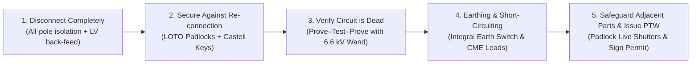
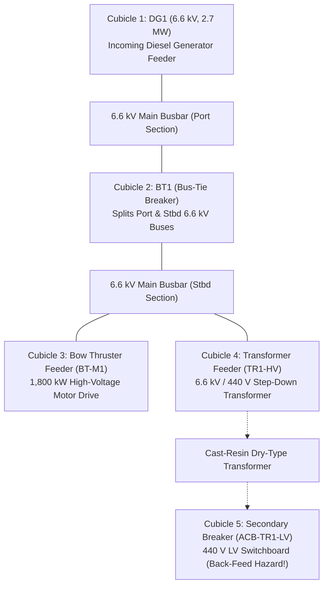

# Marine High Voltage (6.6 kV) Switching & Permit-to-Work (PTW) Simulator

[](./LICENSE)
[](https://www.imo.org/)
[](https://webstore.iec.ch/)
[](https://www.gov.uk/government/publications/code-of-safe-working-practices-for-merchant-seafarers-2024)
[-success.svg)](#)

A production-grade, zero-dependency **Marine High Voltage (6.6 kV, 60 Hz) Switching & Permit-to-Work (PTW) Simulator** designed for **Electro-Technical Officer (ETO)** cadets, Marine Chief Engineers, and maritime electrical engineering students.

This simulator models industrial marine medium-voltage switchgear (based on the **ABB UniGear ZS1** / **Schneider MCset** marine architectures) to teach and assess high-voltage safe isolation, mechanical and Castell trapped-key interlocks, withdrawable Vacuum Circuit Breaker (VCB) racking, live-line *Prove–Test–Prove* verification, integral and portable earthing (Circuit Main Earth - CME), Lockout/Tagout (LOTO), 5,000 V DC Insulation Resistance / Polarization Index testing, and formal maritime Permit-to-Work (PTW) issuance.

---

## ⚡ Live Demo & Quick Start (Zero Build Step)

* **Online via GitHub Pages:** [https://jro-d.github.io/marine-hv-2d-simulator/](https://jro-d.github.io/marine-hv-2d-simulator/)
* **Offline / Local Run:** Simply clone this repository and double-click [`index.html`](./index.html) or [`marine-hv-simulator.html`](./marine-hv-simulator.html) in any modern browser (Chrome, Edge, Firefox, Safari).
* **No Node.js, no npm, no build pipelines, and no external CDNs required** — everything runs completely offline.

---

## 🛡️ Regulatory & Maritime Law Compliance

Every mechanical interlock, warning tag, switching sequence, and assessment deduction in this simulator strictly adheres to international maritime safety codes:

| Regulatory Standard | Scope & Mandatory Rules Enforced |
| :--- | :--- |
| **STCW 2010 Manila Amendments**<br>*(Table A-III/6 & Section B-III/2)* | Mandatory minimum standard of competence for certification of Electro-Technical Officers (High Voltage $>1,000\text{ V}$ AC). Requires pre-use glove pneumatic air-leak testing, arc-flash boundary discipline, and PTW authorization. |
| **IEC 60092-503**<br>*(Marine AC Supply Above 1 kV)* | Mandatory fail-safe mechanical interlocks between circuit breakers, withdrawable carriages, automatic safety shutters, integral fault-making earthing switches, and enclosure access doors. |
| **UK MCA COSWP — Chapter 22**<br>*(Code of Safe Working Practices)* | Enforces the **5 Golden Rules of Marine HV Safety** across all high-voltage switching operations on UK-flagged and international commercial tonnage. |

### The 5 Golden Rules of Marine HV Safety



---

## ⚙️ Switchboard Topology (6.6 kV / 440 V Marine System)

The simulator models a 6.6 kV, 60 Hz 3-phase insulated-neutral marine electrical distribution system with an interconnected 440 V low-voltage sub-panel:



---

## 🎯 4 Built-In Training & Assessment Missions

### Mission 01: Bow Thruster 6.6 kV Motor Isolation & PTW (`BT-M1`)
* **Objective:** Safely isolate, rack out, earth, and issue a Permit-to-Work for maintenance on the 1,800 kW Bow Thruster variable frequency drive.
* **Key Tasks:** Full HV PPE $\rightarrow$ Pneumatic glove air-test $\rightarrow$ Local VCB trip $\rightarrow$ 20-turn continuous racking (`SERVICE` $\rightarrow$ `TEST` $\rightarrow$ `DISCONNECTED`) $\rightarrow$ Castell key `K1-BT` extraction $\rightarrow$ Transfer key to Integral Earth Switch $\rightarrow$ Slam close and padlock Earth Switch $\rightarrow$ Lock keys in Safety Key Box $\rightarrow$ Open cubicle door $\rightarrow$ Padlock red busbar shutter $\rightarrow$ 3-step *Prove–Test–Prove* verification $\rightarrow$ Formal PTW signing.

### Mission 02: 6.6 kV / 440 V Transformer Dual-End Isolation (Back-Feed Trap)
* **Objective:** Isolate Transformer TR1 for inspection without falling into the lethal low-voltage step-up back-feed trap.
* **The Engineering Trap:** If an engineer isolates only the 6.6 kV primary breaker, an energized 440 V LV busbar will back-feed $440\text{ V}$ into the secondary windings, **stepping it back up to lethal 6,600 V on the primary terminals!**
* **Procedure:** Must isolate and lock out 440 V secondary breaker `ACB-TR1-LV` **FIRST** and extract key `K-LV`, then isolate 6.6 kV primary breaker `TR1-HV` and extract key `K-HV`. Both keys (`K-HV` + `K-LV`) must be inserted into the dual-key Castell interlock before the Earth Switch can be closed.

### Mission 03: Sanction-for-Test & 5 kV Insulation Resistance / PI Megger Test (`BT-M1`)
* **Objective:** Cancel the active PTW, issue a Sanction-for-Test (SFT), and perform a 5,000 V DC Megger & Polarization Index test on the isolated motor feeder.
* **Critical Life-Safety Rules:**
  1. Cannot Megger an earthed circuit: Must unlock and open the Earth Switch under SFT authorization.
  2. **Capacitive Charge Bleed (Crucial):** After applying 5,000 V DC for 10 minutes, the motor windings store an electrostatic charge of $\approx 4,850\text{ V DC}$. You must bleed the winding charge back to $0\text{ V}$ before touching the leads! Disconnecting leads while charged results in an immediate safety violation.

### Mission 04: De-Isolation & Safe Restoration to 6.6 kV Service (`BT-M1`)
* **Objective:** Cancel all safety documentation, remove earths in reverse order, restore switchgear mechanicals, and return the Bow Thruster to sea service.
* **The Reverse CME Rule:** When removing Portable Earths, always unclamp phase terminals (`L1, L2, L3`) via Hot-Stick **FIRST**, and unclamp the ship's `PE` earth bar **LAST**. Removing `PE` first leaves ungrounded phase conductors with high induced voltages in your hands!
* **Restoration:** Bolt door $\rightarrow$ Re-open Earth Switch $\rightarrow$ Return `K1-BT` to VCB $\rightarrow$ Rack to `TEST (10/20)` for local Close/Trip verification $\rightarrow$ Rack to `SERVICE (20/20)` $\rightarrow$ Transfer control to `REMOTE`.

---

## 🎨 Industrial 2.5D Animated Switchgear Interface

```
+--------------------------------------------------------------------------------------------------+
| CUBICLE 3: BOW THRUSTER HV MOTOR FEEDER (BT-M1)       [⚠️ DANGER] [⏚ EARTHED]        CLOSED [I]   |
+--------------------------------------------------------------------------------------------------+
| [ VACUUM CIRCUIT BREAKER (VCB) ]                  | [ INTEGRAL FAULT-MAKING EARTH SWITCH ]       |
| 1. Mechanical Inspection Windows:                 | 1. Earth Switch Snap-Blade Mimic:            |
|   +----------------+ +--------------+ +---------+ |   - 3 Copper Blades rotate dynamically:      |
|   | MAIN CONTACTS  | | SPRING MECH  | | CYCLES  | |     • 45° angled up when OPEN (Unearthed)    |
|   |  [I] CLOSED    | |  ⚡ CHARGED  | | 0 0 1 4 2| |     • Vertical down onto hull ground bar     |
|   +----------------+ +--------------+ +---------+ |       when ⏚ EARTHED (Circuit Main Earth)    |
|                                                   |                                              |
| 2. Withdrawable Truck & Rails Cutaway:            | 2. Position Indicator Dial:                  |
|   - Visual cross-section with stationary spouts,  |   - Green "OPEN" vs Yellow "⏚ EARTHED"       |
|     copper bushings, and carriage wheels.         |                                              |
|   - As you crank turns (0 -> 10 -> 20):           | 3. Castell Earth Interlock Cylinder:         |
|     • 0/20: Truck slides back (AIR-GAP BADGE)     |   - Real-time key status with interactive    |
|     • 10/20: TEST position (Air gap maintained)   |     [🔑 Insert Key] / [✓ Inserted]          |
|     • 20/20: Contacts mate with spouts            |                                              |
|                                                   | 4. Capacitive Voltage Indicators (CVI):      |
| 3. Racking Port & Castell Key Barrel:             |   - Flush industrial 3-phase module          |
|   - Real-time padlock status & brass key slot     |   - Neon amber/red LEDs with live pulse      |
|                                                   |     glow when energized; dark when 0.0 kV    |
+---------------------------------------------------+----------------------------------------------+
```

### Realistic Switchgear Features
* **Physical Mechanical Target Windows:** Rotating drum flags for Main Contacts (`[I] CLOSED` in red / `[O] OPEN` in green) and Spring Mechanism (`⚡ CHARGED` in yellow / `DISCHARGED` in white).
* **Withdrawable Carriage Kinematics:** Dynamic cross-section of the cubicle floor and steel guide rails showing the VCB truck rolling on wheels between `DISCONNECTED` $\rightarrow$ `TEST` $\rightarrow$ `SERVICE`.
* **Openable Enclosure Interior (`INTERIOR` View):**
  * **Red Safety Drop-Shutter:** Drops over the 6.6 kV live upstream busbars with diagonal hazard chevron striping (`⚠ DANGER 6.6 kV LIVE BUSBARS`) and LOTO padlock hasp.
  * **Lower Cable Chamber:** Deep cast-resin spout bushings with silver-plated tulip contact jaws and solid hull ground busbar.
  * **Touch Targets:** Probe terminals with the 6.6 kV wand or clamp flexible yellow **Portable Earth Leads (CME)**.
* **Pulsing CVI LEDs:** Flush-mounted Capacitive Voltage Indicator block with pulsing neon LEDs that glow when energized and extinguish when dead.

---

## 📖 Floating Interactive Tutorial Guide

The simulator features a non-modal, draggable **Floating Tutorial Guide** (`#helpFloat`):
* **Draggable & Non-Modal:** Drag anywhere across the screen without blocking switchgear controls.
* **Minimize & Wide Modes:** Collapse to a slim title bar (`_`) or expand to a wide split-screen view (`🗖`).
* **Tab 1: Interactive Walkthrough:** Step-by-step guidance showing exact *"Where to look"* cues and idempotent `[▶ Do This Step]` buttons.
* **Tab 2: The 5 Golden Rules:** Deep-dive into UK MCA COSWP Chapter 22 and IEC 60092-503 regulations.
* **Tab 3: All 4 Missions Explained:** Complete briefing dossiers and operational guidelines.
* **Tab 4: Interlocks & Traps FAQ:** Troubleshooting guide explaining why interlocks latch, Castell key transfers, Megger charging rules, and reverse CME procedures.

---

## 🔊 Web Audio API Acoustic Synthesis

Zero external audio files. All sounds are procedurally generated in real time using the browser's native **Web Audio API**:
* Heavy spring-discharge breaker trip (`CLACK-BANG!`).
* Lead-screw ratcheting metallic clicks during racking crank rotations.
* High-speed snap-action clunk of the spring-assisted Earth Switch.
* 6.6 kV Proving Wand high-frequency electronic warble.
* Class 2 rubber glove pneumatic air-release whistle.

---

## 📂 Project Structure

```
marine-hv-2d-simulator/
├── index.html                   # Main standalone entry point (commit for GitHub Pages)
├── marine-hv-simulator.html     # Mirror standalone single-file distribution
├── README.md                    # Technical documentation and operational manual
├── LICENSE                      # MIT Open-Source License
├── .gitignore                   # Workspace exclusions
├── HV_SIMULATOR_HANDOVER.md     # Detailed pedagogical & engineering specification
└── skill.md                     # Agent skill definition for marine CAD simulators
```

---

## 📜 License

This project is licensed under the **MIT License** — see the [`LICENSE`](./LICENSE) file for details.

Developed for marine engineering cadets, ETO candidates, and high-voltage training institutions worldwide.
